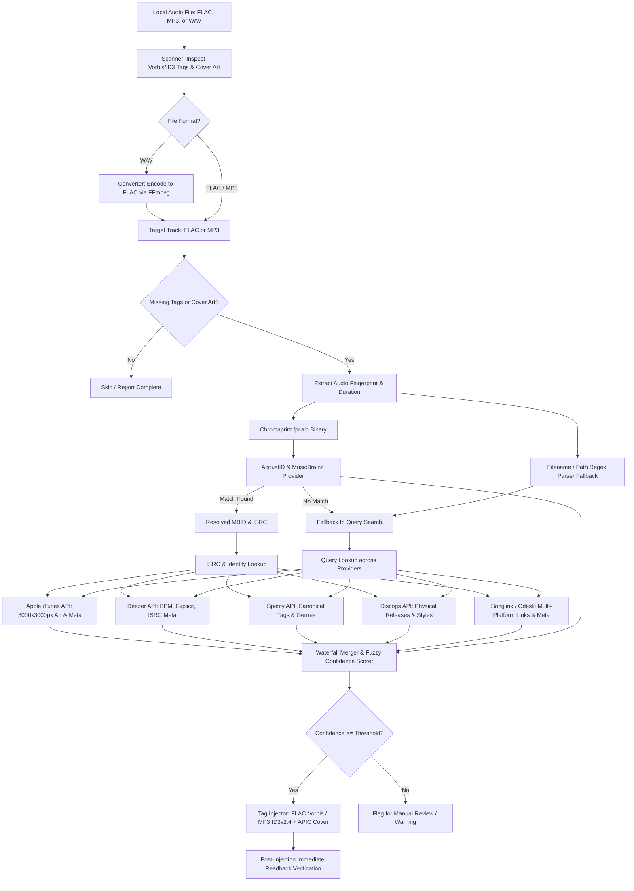
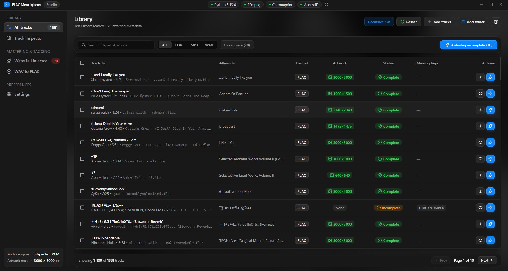
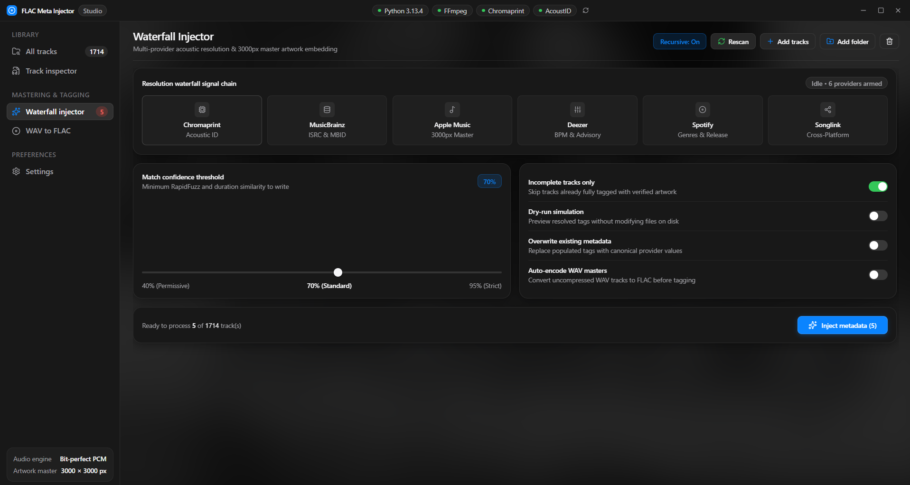
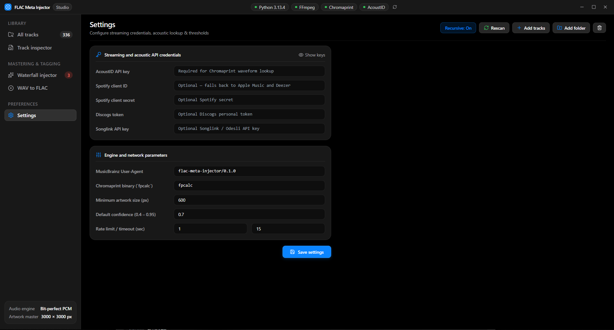
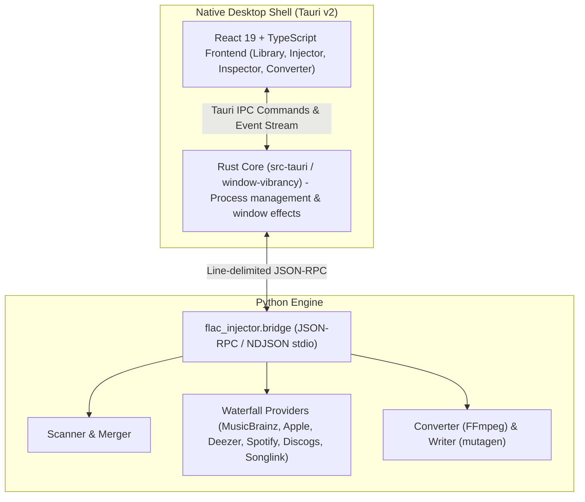

# flac-meta-injector

[](https://www.python.org/downloads/)
[](https://opensource.org/licenses/MIT)
[](https://github.com/astral-sh/ruff)

A CLI and Python library that scans local audio files (**FLAC** and **MP3**), converts uncompressed **WAV** tracks into FLAC, queries music streaming services and databases for canonical track identity, and writes standardized **Vorbis Comments / ID3v2.4 tags** and **cover art (up to 3000x3000px)**.

### Why flac-meta-injector?

Curating local lossless music libraries frequently suffers from:
- Incomplete or missing tags where stripped filenames make acoustic waveform recognition essential.
- Low-resolution embedded thumbnails (e.g., 300x300px) that look pixelated on modern displays.
- Incorrect compound-artist splitting that mangles collaborative artist tags (e.g., breaking bands like *Earth, Wind & Fire* into separate artist entries).
- Unstandardized WAV containers that lack native metadata headers.

`flac-meta-injector` solves these issues through a deterministic acoustic fingerprinting and multi-provider waterfall pipeline, injecting clean tags and high-resolution cover artwork directly into audio headers without re-encoding audio streams.

---

## Key Features

- **Multi-Format Lossless Metadata Tagging**: Direct container and tag manipulation via Mutagen (FLAC Vorbis Comments & Picture blocks; MP3 ID3v2.4 & APIC frames) without audio stream re-encoding.
- **Multi-Artist Separation & Compound Band Preservation**: Collaborating artists (delimited by commas, semicolons, slashes, or `feat.`/`ft.`/`&`) are written as individual `ARTIST` entries in FLAC Vorbis comments (repeated tags) and ID3v2.4 `TPE1` lists, while preserving known compound artist names (e.g. *Earth, Wind & Fire*, *Tyler, The Creator*, *AC/DC*, *Simon & Garfunkel*).
- **WAV to FLAC Conversion**: FFmpeg-powered conversion of uncompressed `.wav`, `.wave`, and `.aiff` files to FLAC with configurable compression levels and post-conversion tagging.
- **Acoustic Audio Fingerprinting**: Uses Chromaprint (`fpcalc`) and AcoustID to identify tracks by audio waveform, enabling identification even when existing tags or filenames are missing or inaccurate.
- **Multi-Provider Waterfall Pipeline**:
  - **AcoustID & MusicBrainz**: Authoritative MusicBrainz IDs (`MUSICBRAINZ_TRACKID`, `MUSICBRAINZ_ALBUMID`), artist credits, and ISRC (International Standard Recording Code).
  - **Apple iTunes Search API**: Unauthenticated public search endpoint, retrieving cover artwork up to **3000x3000px** directly from Apple's CDN by rewriting image URL dimensions.
  - **Deezer Public API**: Unauthenticated public endpoint providing track **BPM (tempo)** estimates, explicit advisory ratings, and ISRC validation.
  - **Spotify Web API**: Enriched streaming metadata via Client Credentials flow.
  - **Discogs Database API**: Extensive physical and niche release catalog with styles, compositions, label catalog numbers, and detailed credits.
  - **Songlink / Odesli Resolver**: Cross-platform music link resolution (Spotify, Apple Music, Deezer, YouTube, Tidal) and streaming URL tag injection.
- **Fuzzy Confidence Scoring**: Uses RapidFuzz token sorting and duration discrepancy penalties (`|Δduration| > 3s`) to mitigate false-positive tag injection.
- **Interactive CLI**: Built with Typer and Rich, featuring formatted scan tables with audio format indicators, before/after inspection, dry-run simulation, and immediate post-write read-back verification.

---

## Architecture & Resolution Waterfall



---

## Prerequisites & System Dependencies

`flac-meta-injector` requires **Python 3.11+** and two external CLI binaries:
1. **`ffmpeg`** (used for audio conversion and audio analysis)
2. **`fpcalc`** (Chromaprint acoustic fingerprint generator)

### Installing System Dependencies

#### Windows (via WinGet or Chocolatey)
```powershell
# Using WinGet (Recommended)
winget install Gyan.FFmpeg.Essentials
winget install AcoustID.Chromaprint

# Or using Chocolatey
choco install ffmpeg chromaprint
```

#### macOS (via Homebrew)
```bash
brew install ffmpeg chromaprint
```

#### Linux (Debian / Ubuntu)
```bash
sudo apt-get update
sudo apt-get install -y ffmpeg libchromaprint-tools
```

### Desktop Application Dependencies (Optional, for GUI Development)

If developing or building the native Windows desktop application:
1. **Node.js** (v18+) and **npm** (or **pnpm**)
2. **Rust** (1.78+) and **Cargo**
3. **Microsoft C++ Build Tools** (Visual Studio MSVC) & **WebView2 Runtime** (pre-installed on Windows 11)

---

## Installation

1. **Clone the repository**:
   ```bash
   git clone https://github.com/PeterMaks/flac-meta-injector.git
   cd flac-meta-injector
   ```

2. **Create and activate a virtual environment**:
   ```bash
   # Windows PowerShell
   python -m venv .venv
   .\.venv\Scripts\Activate.ps1

   # Linux / macOS
   python3 -m venv .venv
   source .venv/bin/activate
   ```

3. **Install dependencies in editable mode**:
   ```bash
   pip install -e ".[dev]"
   ```

---

## Configuration (`.env`)

Copy `.env.example` to `.env` to customize operational settings or configure optional provider credentials:

```bash
cp .env.example .env
```

| Environment Variable | Default Value | Description |
|---|---|---|
| `ACOUSTID_API_KEY` | *(Built-in open key)* | Your AcoustID API key (register for free at [acoustid.org](https://acoustid.org/)). |
| `SPOTIFY_CLIENT_ID` | `None` *(Optional)* | Spotify Developer Client ID for enhanced streaming metadata. |
| `SPOTIFY_CLIENT_SECRET` | `None` *(Optional)* | Spotify Developer Client Secret. |
| `DISCOGS_TOKEN` | `None` *(Optional)* | Discogs Personal Access Token (generate at [discogs.com/settings/developers](https://www.discogs.com/settings/developers)). |
| `SONGLINK_API_KEY` | `None` *(Optional)* | Songlink / Odesli API key (or `ODESLI_API_KEY`) for authenticated streaming queries. |
| `MUSICBRAINZ_USER_AGENT` | `flac-meta-injector/...` | User-Agent header compliant with MusicBrainz terms. |
| `RATE_LIMIT_DELAY` | `1.0` | Minimum delay in seconds between calls to polite endpoints (MusicBrainz / Discogs). |
| `REQUEST_TIMEOUT` | `15.0` | HTTP request timeout in seconds for provider endpoints. |
| `COVER_ART_MIN_RESOLUTION` | `600` | Minimum acceptable cover art width/height in pixels. |
| `CONFIDENCE_THRESHOLD` | `0.70` | Minimum composite confidence score (0.0 to 1.0) to auto-inject tags. |
| `FFMPEG_PATH` | `ffmpeg` | Path or command name for the `ffmpeg` executable. |
| `FPCALC_PATH` | `fpcalc` | Path or command name for the `fpcalc` executable. |

> **Note:** **Apple iTunes**, **Deezer**, and **Songlink / Odesli** operate without mandatory API keys or credentials. If Spotify, Discogs, or AcoustID keys are omitted, the tool automatically uses public endpoints and filename heuristics.

---

## CLI Usage & Command Reference

The command-line interface is available via `flac-meta-injector` or `python -m flac_injector.cli`.

```text
Usage: flac-meta-injector [OPTIONS] COMMAND [ARGS]...

Options:
  -h, --help   Show help message with all available commands and exit.

Commands:
  scan            Scan audio files (FLAC, MP3, WAV) and report metadata and cover art completeness.
  inspect         Inspect detailed tags, properties, and cover art blocks of an audio file.
  fingerprint     Generate Chromaprint fingerprint and parse filename heuristics.
  inject          Scan and inject standardized metadata and cover art into FLAC and MP3 files.
  match-spotify   Compare and match audio files against exported Spotify data (CSV or JSON).
  import-spotify  Alias for match-spotify: import Spotify export and fill metadata gaps.
  clean-art       Deduplicate embedded picture blocks, purge legacy picture tags, and clean loose folder images.
  convert         Convert WAV / uncompressed audio files into FLAC and optionally inject tags.
```

---

### 1. `scan` — Audit Missing Tags & Cover Art (FLAC, MP3, WAV)

Scans a single audio file or an entire directory tree and renders a formatted table showing format, metadata health, missing core fields, and cover art resolution.

```bash
# Scan a folder recursively
flac-meta-injector scan ./music/

# Scan only the top-level directory (non-recursive)
flac-meta-injector scan ./music/ --no-recursive

# Show only incomplete files missing tags or art
flac-meta-injector scan ./music/ --only-incomplete
```

**Example Output:**
```text
                          Audio Metadata Scan Results                          
┌─────────┬────────┬─────────┬─────────┬─────────┬─────────┬─────────┬────────┐
│ Track / │        │         │         │         │  Cover  │         │ Missi… │
│ Path    │ Format │ Title   │ Artist  │ Album   │   Art   │ Status  │ Fields │
├─────────┼────────┼─────────┼─────────┼─────────┼─────────┼─────────┼────────┤
│ Daft    │  FLAC  │ One     │ Daft    │ Vitamin │   OK    │ COMPLE… │ -      │
│ Punk -  │        │ More    │ Punk    │ House   │ (3000x… │         │        │
│ One     │        │ Time    │         │         │         │         │        │
│ More    │        │         │         │         │         │         │        │
│ Time.f… │        │         │         │         │         │         │        │
│ Daft    │  MP3   │ Techno… │ Daft    │ Human   │   OK    │ COMPLE… │ -      │
│ Punk -  │        │         │ Punk    │ After   │ (1500x… │         │        │
│ Techno… │        │         │         │ All     │         │         │        │
│ Kraftw… │  WAV   │ -       │ -       │ -       │ MISSING │ INCOMP… │ ALBUM, │
│ - The   │        │         │         │         │         │         │ ARTIS… │
│ Robots… │        │         │         │         │         │         │ DATE,  │
└─────────┴────────┴─────────┴─────────┴─────────┴─────────┴─────────┴────────┘
┌─────────────────────────────── Scan Summary ────────────────────────────────┐
│ Total Scanned: 3 (FLAC: 1  |  MP3: 1  |  WAV: 1)  |  Complete: 2  |         │
│ Incomplete: 1                                                               │
└─────────────────────────────────────────────────────────────────────────────┘
```

---

### 2. `inspect` — Detailed Tag & Picture Block Viewer

Performs deep introspection of a FLAC, MP3, or WAV file, displaying audio stream properties, all existing Vorbis comments / ID3 frames, and embedded cover art specifications.

```bash
# Inspect a FLAC file
flac-meta-injector inspect ./music/track.flac

# Inspect an MP3 file
flac-meta-injector inspect ./music/track.mp3

# Inspect a WAV file
flac-meta-injector inspect ./music/recording.wav
```

**Example Output (MP3 with ID3v2.4 and APIC Cover Art):**
```text
┌────────────────────────── Audio Stream Properties ──────────────────────────┐
│ Path: ./music/Daft Punk - Technologic.mp3                                   │
│ Format: MP3                                                                 │
│ Duration: 04:44 (284.12s)                                                   │
│ Specs: 44100 Hz, 2 Ch, 16-bit                                               │
└─────────────────────────────────────────────────────────────────────────────┘
            ID3 Tags             
┌─────────────┬─────────────────┐
│ Tag Key     │ Value(s)        │
├─────────────┼─────────────────┤
│ ALBUM       │ Human After All │
│ ALBUMARTIST │ Daft Punk       │
│ ARTIST      │ Daft Punk       │
│ DATE        │ 2005-03-09      │
│ DISCNUMBER  │ 1/1             │
│ GENRE       │ House           │
│ ISRC        │ GBDUW0400109    │
│ TITLE       │ Technologic     │
│ TRACKNUMBER │ 9               │
│ TRACKTOTAL  │ 10              │
└─────────────┴─────────────────┘
┌─────────── Attached Picture (APIC) ───────────┐
│ Type: Cover (front) (PictureType.COVER_FRONT) │
│ MIME: image/jpeg                              │
│ Resolution: 1500x1500                         │
│ Bit Depth: 24-bit                             │
│ Size: 273.9 KB                                │
└───────────────────────────────────────────────┘
```

---

### 3. `inject` — Resolve & Inject Metadata into FLAC and MP3

Executes the waterfall pipeline to resolve and write canonical metadata and high-res cover art.

```bash
# 1. Preview changes safely without modifying files (Dry-Run mode)
flac-meta-injector inject ./music/ --dry-run

# 2. Inject missing metadata and cover art into a single FLAC or MP3
flac-meta-injector inject ./music/track.mp3

# 3. Inject across a folder with a custom confidence threshold (0.0 to 1.0)
flac-meta-injector inject ./music/ --threshold 0.75

# 4. Force-overwrite existing tags with fresh canonical metadata
flac-meta-injector inject ./music/ --overwrite

# 5. Disable auto-converting WAV files when processing mixed folders
flac-meta-injector inject ./music/ --no-convert-wav
```

**CLI Flags for `inject`:**
- `--dry-run`: Simulates provider resolution and prints what tags and artwork would be written without altering disk files.
- `--threshold, -t FLOAT`: Minimum confidence score (default `0.70`) required to execute injection.
- `--overwrite`: Overwrites existing non-empty tags (default: `False`, preserving existing non-empty tags).
- `--overwrite-art`: Force re-resolves and replaces album art even if text metadata is already complete.
- `--overwrite-unknown`: Selectively overwrites only tracks whose album tag is `"Unknown Album"` or missing.
- `--overwrite-album <name>`: Selectively overwrites tracks matching a specific album tag (e.g. `--overwrite-album "Unknown Album"`).
- `--song-link, --url <url>`: Direct song.link or streaming platform link (Spotify, Apple Music, Deezer, YouTube) to resolve metadata and cover art directly.
- `--convert-wav / --no-convert-wav`: Auto-converts any discovered WAV files to FLAC and injects tags into the resulting FLAC (default: `True`).
- `--recursive / --no-recursive, -r`: Recurse into subdirectories (default: `True`).

> **Hardware Player & DAP Compatibility:** While 3000x3000px cover art renders crisply on 4K and Retina displays, certain legacy digital audio players (DAPs) or automotive infotainment units with low embedded memory may struggle with image frames exceeding 2MB. Use `--overwrite-art` or folder-level artwork if targeting memory-constrained hardware.

---

### 4. `match-spotify` (alias: `import-spotify`) — Match & Fill Metadata from Spotify Export (CSV / JSON)

Imports manual or exported Spotify playlist/library data (from Exportify, Spotlistr, Soundiiz, TuneMyMusic, or raw Spotify Web API JSON) and automatically compares, similarity-matches, and fills metadata gaps in your local audio files (FLAC, MP3, WAV).

**Key Matching Behavior:**
- **Similarity Threshold Filter**: Only audio files matching Spotify tracks above the similarity threshold (`--threshold`, default `0.70`) have their metadata updated. Files below threshold are skipped.
- **Dual-Source Matching (Tags & Filename)**: Compares Spotify tracks against both embedded audio tags and parsed filenames (e.g. `Artist - Title.flac`), allowing identification when internal tags are missing or invalid.
- **Automatic Mismatched Tag Overwrite**: When a file matches a Spotify track via filename but internal tags diverge (< 70% similarity), those mismatched core tags (Artist, Title, Album) are selectively updated with verified Spotify metadata without requiring full `--overwrite`.
- **Metadata Gap Filling**: Existing non-empty tags are preserved while missing tags are populated (Album, Release Date, Genres, Record Label, BPM, Explicit flag, ISRC, Spotify Track ID, and audio features).
- **Full Overwrite Support**: Pass `--overwrite` to replace all existing non-empty tags with values from the Spotify dataset.
- **Multi-Format Ingestion**: Supports `.csv`, `.tsv`, and `.json` exports with automatic column detection (supporting headers: `Track Name`, `Artist Name(s)`, `Album Name`, `Spotify Track ID`, `ISRC`).

```bash
# 1. Preview similarity matching and proposed tag updates safely (Dry-Run mode)
flac-meta-injector match-spotify ./music/ ./spotify_playlist.csv --dry-run

# 2. Match and fill metadata gaps in local files from a Spotify CSV export
flac-meta-injector match-spotify ./music/ ./spotify_playlist.csv

# 3. Match from a JSON export with custom similarity threshold (e.g. 75%)
flac-meta-injector match-spotify ./music/ ./spotify_tracks.json --threshold 0.75

# 4. Overwrite existing tags with Spotify export data on matched songs
flac-meta-injector match-spotify ./music/ ./spotify_playlist.csv --overwrite

# 5. Using the import-spotify alias with --data flag
flac-meta-injector import-spotify ./music/ --data ./spotify_playlist.csv
```

**CLI Flags for `match-spotify` / `import-spotify`:**
- `target`: Path to audio file or directory.
- `data_file`: Path to Spotify CSV or JSON file (also available via `--data, -d`).
- `--threshold, -t FLOAT`: Minimum similarity score required to match (default: `0.70`).
- `--dry-run`: Preview matches, similarity scores, and proposed tag updates without modifying disk files.
- `--overwrite`: Overwrites existing non-empty tags instead of only filling missing gaps (default: `False`).
- `--overwrite-mismatched / --no-overwrite-mismatched`: Overwrites discordant artist/title/album tags when matched via filename (default: `True`).
- `--overwrite-art`: Replaces embedded cover art if available from matched Spotify records.
- `--fetch-art`: Resolves and downloads master album art from providers for matched tracks (default: `False`).
- `--convert-wav / --no-convert-wav`: Auto-converts WAV files to FLAC before matching (default: `True`).
- `--recursive / --no-recursive, -r`: Recurse into subdirectories (default: `True`).

---

### 5. `convert` — Convert WAV / Audio to FLAC with Auto-Injection

Losslessly encodes uncompressed audio files (`.wav`, `.wave`, `.aiff`, `.aif`) to FLAC using FFmpeg, and automatically resolves and injects metadata into the resulting tracks.

```bash
# 1. Convert a WAV file to FLAC and auto-inject metadata and cover art
flac-meta-injector convert ./music/recording.wav

# 2. Convert an entire folder of WAV files into a dedicated FLAC directory
flac-meta-injector convert ./uncompressed_wavs/ --output-dir ./flac_library/

# 3. Convert and delete source WAV files only after verified conversion
flac-meta-injector convert ./music/ --delete-original

# 4. Convert without injecting metadata (pure audio conversion)
flac-meta-injector convert ./music/ --no-inject

# 5. Customize FLAC compression level (0-12, default 8)
flac-meta-injector convert ./music/ --compression-level 8
```

**CLI Flags for `convert`:**
- `--output-dir, -o PATH`: Optional destination folder for converted FLAC files.
- `--inject / --no-inject`: Automatically resolve and inject metadata after conversion (default: `True`).
- `--delete-original`: Deletes the source WAV file only after verified FLAC encoding and valid stream verification (default: `False`).
- `--compression-level, -c INT`: FLAC compression level (0–12, default: `8`).
- `--threshold, -t FLOAT`: Minimum confidence threshold for auto-injection (default: `0.70`).
- `--recursive / --no-recursive, -r`: Recurse into subdirectories (default: `True`).
- `--dry-run`: Preview conversion paths without modifying files.

---

### 6. `clean-art` — Deduplicate & Purge Repeating Album Art

Deduplicates multiple embedded Picture blocks (e.g., duplicate Type 0 "Other" and Type 3 "Front Cover" blocks), purges legacy Vorbis comment picture tags (`METADATA_BLOCK_PICTURE`, `COVERART`), and optionally removes loose image files (`folder.jpg`, `cover.jpg`) that override embedded artwork in file managers and media players.

```bash
# 1. Preview deduplication across files without modifying them
flac-meta-injector clean-art ./music/ --dry-run

# 2. Clean duplicate embedded picture blocks in a library
flac-meta-injector clean-art ./music/

# 3. Clean embedded art and remove loose folder.jpg/cover.jpg files
flac-meta-injector clean-art ./music/ --remove-folder-art
```

---

### 7. `fingerprint` — Acoustic Fingerprint & Heuristic Parser

Runs `fpcalc` against an audio file, prints its Chromaprint representation, and parses candidate hints from filenames and directory hierarchies.

```bash
flac-meta-injector fingerprint ./music/"01 - Daft Punk - One More Time.mp3"
```

---

## Python Library Quickstart

`flac-meta-injector` can also be used programmatically in Python applications:

```python
from pathlib import Path
from flac_injector.scanner import AudioScanner
from flac_injector.waterfall import WaterfallMerger
from flac_injector.writer import MetadataWriter

# 1. Scan existing tags and artwork status
scanner = AudioScanner()
track_info = scanner.scan_file(Path("music/track.flac"))

# 2. Query multi-provider waterfall with acoustic fingerprinting
merger = WaterfallMerger()
result = await merger.resolve(track_info)

# 3. Inject canonical tags and artwork if confidence meets threshold
if result and result.confidence >= 0.70:
    writer = MetadataWriter()
    writer.write_metadata(Path("music/track.flac"), result.metadata)
```

---

## Standard Tag Mapping Across Formats

`flac-meta-injector` automatically maps canonical metadata across both **FLAC Vorbis Comments** and **MP3 ID3v2.4 frames**:

| Canonical Field | FLAC Vorbis Tag | MP3 ID3v2.4 Frame | Example Value |
|---|---|---|---|
| Track Title | `TITLE` | `TIT2` | `One More Time` |
| Lead Artist | `ARTIST` | `TPE1` | `Daft Punk` |
| Album Name | `ALBUM` | `TALB` | `Discovery` |
| Album Artist | `ALBUMARTIST` | `TPE2` | `Daft Punk` |
| Track Number / Total | `TRACKNUMBER`, `TRACKTOTAL` | `TRCK` (`num/total`) | `1/14` |
| Disc Number / Total | `DISCNUMBER`, `DISCTOTAL` | `TPOS` (`num/total`) | `1/1` |
| Release Date | `DATE`, `YEAR` | `TDRC` | `2001-03-12` |
| Genre(s) | `GENRE` | `TCON` | `Electronic` |
| ISRC Code | `ISRC` | `TSRC` | `GBDUW0100055` |
| Tempo (BPM) | `BPM` | `TBPM` | `123.0` |
| Advisory | `ITUNESADVISORY` | `TXXX:ITUNESADVISORY` | `1` (Explicit) / `2` (Clean) |
| MusicBrainz Recording ID | `MUSICBRAINZ_TRACKID` | `TXXX:MusicBrainz Track Id` | `fad84787-...` |
| MusicBrainz Album ID | `MUSICBRAINZ_ALBUMID` | `TXXX:MusicBrainz Album Id` | `aca0f087-...` |
| MusicBrainz Artist ID | `MUSICBRAINZ_ARTISTID` | `TXXX:MusicBrainz Artist Id` | `a10d33c3-...` |
| AcoustID Identifier | `ACOUSTID_ID` | `TXXX:Acoustid Id` | `83907c08-...` |
| Barcode / UPC | `BARCODE` | `TXXX:BARCODE` | `075678665715` |
| Record Label | `ORGANIZATION`, `LABEL` | `TPUB` | `Daft Life Ltd.` |
| Copyright | `COPYRIGHT` | `TCOP` | `2001 Daft Life Ltd.` |
| Composer | `COMPOSER` | `TCOM` | `Thomas Bangalter, Guy-Manuel de Homem-Christo` |
| Cover Artwork | `Picture Block (Type 3)` | `APIC (Type 3: Front)` | Up to **3000x3000px** (JPEG/PNG) |

> **Note on ID3v2.4 Tagging:** MP3 tags are written using standard ID3v2.4 with UTF-8 encoding to preserve multi-artist delimiters (`TPE1`) and ISO timestamps (`TDRC`). For legacy car head units or hardware players that only support ID3v2.3, tags can be read using standard media server compatibility layers.

---

## Native Windows Desktop Application (Tauri v2 + React 19)

`flac-meta-injector` features a native, frameless **Windows 11 Desktop Application** built with **Tauri v2 (Rust + WebView2)** and **React 19 + TypeScript + Tailwind CSS**.

<p align="center">
  
</p>

### Desktop Feature Gallery

| **Waterfall Injector** | **Track Inspector** |
|:---:|:---:|
|  |  |
| *6-provider resolution waterfall with confidence scoring and batch execution.* | *Vorbis comments, ID3v2.4 frames, and Chromaprint acoustic fingerprint inspection.* |

| **WAV to FLAC Converter** | **Settings & API Configuration** |
|:---:|:---:|
|  |  |
| *Lossless FFmpeg conversion with compression levels (0–12) and auto-tagging.* | *Acoustic API keys, streaming provider credentials, and network parameter tuning.* |

### Desktop IPC Architecture



> **Python Runtime Discovery:** In local development, the Tauri Rust core spawns the Python bridge process using `python` from the system `PATH` (or your active `.venv` environment). For standalone release installers, the Python bridge and external binaries (`ffmpeg`, `fpcalc`) can be bundled as frozen PyInstaller sidecars.

### Key Desktop Features

- **Native OS Drag-and-Drop**: Drop files or folders directly from Windows Explorer into the UI.
- **Live 6-Node Waterfall Stepper**: Real-time visual progress as tracks move through `Chromaprint` -> `MusicBrainz` -> `iTunes` -> `Deezer` -> `Spotify` -> `Songlink`.
- **Track Inspector & Artwork Viewer**: Inspect Vorbis comments, ID3 frames, and preview high-resolution cover artwork.
- **WAV to FLAC Converter**: Convert uncompressed files with compression level sliders (0–12) and automatic post-conversion tagging.
- **In-App `.env` Settings**: Manage API keys, timeouts, and rate limits directly from the desktop interface.

### Running & Building the Desktop App

```bash
# 1. Enter the desktop directory and install dependencies
cd desktop
npm install

# 2. Run the development desktop application
npm run tauri dev

# 3. Build standalone production Windows binaries (.msi and .exe installer)
npm run tauri build
```

---

## Verification & Testing

The repository includes a comprehensive test suite covering FLAC, MP3, WAV, and Python JSON bridge workflows with synthetic audio fixtures generated via `ffmpeg`:

```bash
# Run the complete test suite
pytest -v

# Run targeted test suites
pytest tests/test_bridge.py -v         # Tauri NDJSON bridge tests
pytest tests/test_converter.py -v      # WAV to FLAC conversion tests
pytest tests/test_mp3.py -v            # MP3 ID3 & APIC injection tests
pytest tests/test_scanner.py -v        # Multi-format scanner tests
pytest tests/test_merger.py -v         # Waterfall and fuzzy match tests
pytest tests/test_providers.py -v      # Async API provider tests
pytest tests/test_writer.py -v         # Mutagen writer verification tests
pytest tests/test_spotify_import.py -v # Spotify CSV/JSON import & similarity tests
pytest tests/test_cli.py -v            # CLI entrypoint and option tests

# Run code quality and linting checks
ruff check src tests

# Verify Desktop TypeScript frontend & Rust backend
cd desktop
npm run build
cd src-tauri
cargo check
```

# Run code quality and linting checks
ruff check src tests

# Verify Desktop TypeScript frontend & Rust backend
cd desktop
npm run build
cd src-tauri
cargo check
```

---

## License

This project is licensed under the MIT License — see the [LICENSE](LICENSE) file for details.

