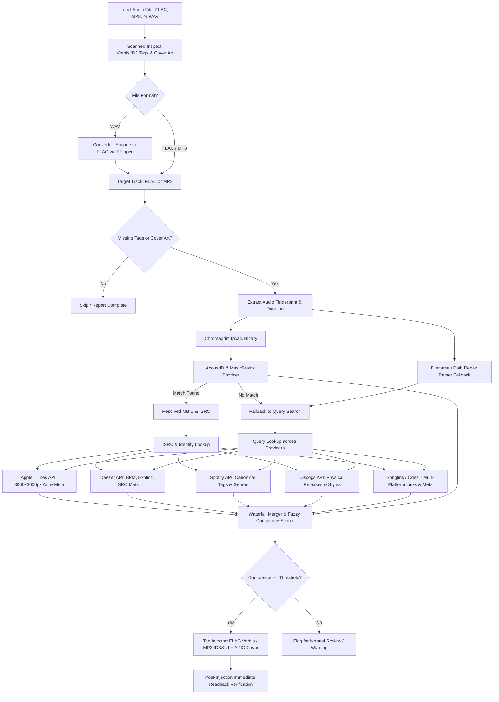
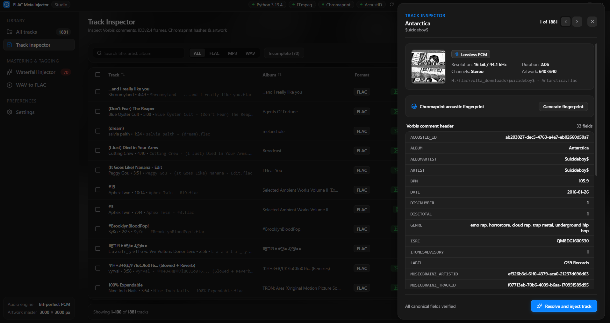
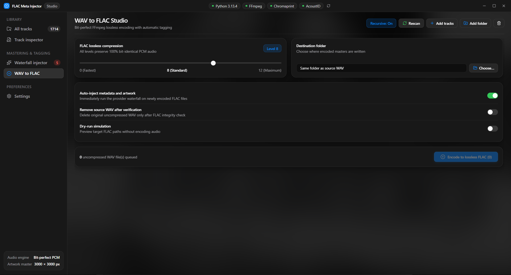
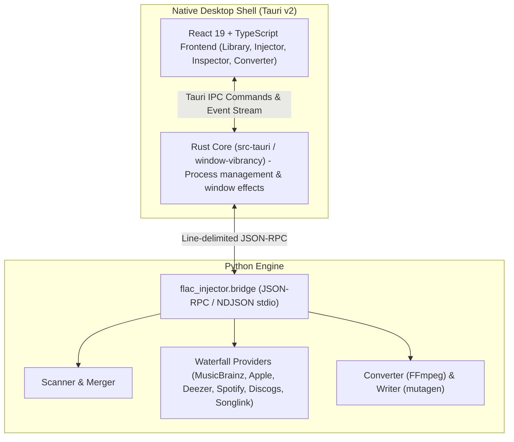

# flac-meta-injector

[](https://www.python.org/downloads/)
[](https://opensource.org/licenses/MIT)
[](https://github.com/astral-sh/ruff)

A CLI and Python library that scans local FLAC and MP3 files, converts WAV tracks to FLAC, queries music databases for track identity, and writes Vorbis comments, ID3v2.4 tags, and cover art up to 3000x3000px.

## Why flac-meta-injector

Local music libraries frequently have these issues:
- Incomplete or missing tags where filenames provide no metadata.
- Low-resolution embedded thumbnails (300x300px) on high-density displays.
- Delimiter-based artist splitters that split compound band names like Earth, Wind & Fire.
- WAV files that lack native metadata headers.

`flac-meta-injector` uses acoustic fingerprinting and a multi-provider waterfall pipeline. It writes tags and high-resolution cover artwork directly into audio headers without re-encoding audio streams.

---

## Key features

- Multi-format metadata tagging. Writes FLAC Vorbis comments, Picture blocks, MP3 ID3v2.4 tags, and APIC frames using Mutagen. Audio streams are never re-encoded.
- Multi-artist separation with compound band preservation. Separates collaborating artists split by commas, semicolons, slashes, or `feat.`, `ft.`, and `&` into individual `ARTIST` entries in FLAC and `TPE1` lists in MP3. Preserves compound band names such as Earth, Wind & Fire, Tyler, The Creator, AC/DC, and Simon & Garfunkel.
- WAV to FLAC conversion. Encodes `.wav`, `.wave`, and `.aiff` files to FLAC using FFmpeg, with configurable compression levels and automatic post-conversion tagging.
- Acoustic audio fingerprinting. Uses Chromaprint (`fpcalc`) and AcoustID to identify tracks from audio waveforms when existing tags or filenames are missing.
- Multi-provider waterfall pipeline.
  - AcoustID and MusicBrainz. Fetches MusicBrainz track and album identifiers, artist credits, and ISRC codes.
  - Apple iTunes search API. Public endpoint that returns cover artwork up to 3000x3000px from the Apple CDN by rewriting image URL dimensions.
  - Deezer public API. Public endpoint that provides track tempo (BPM) estimates, explicit ratings, and ISRC validation.
  - Spotify web API. Retrieves metadata and audio attributes through the Client Credentials flow.
  - Discogs database API. Physical release catalog containing styles, compositions, catalog numbers, and credits.
  - Songlink and Odesli resolver. Resolves cross-platform links for Spotify, Apple Music, Deezer, YouTube, and Tidal.
- Confidence scoring. Uses RapidFuzz token sorting and duration discrepancy penalties for tracks with duration differences greater than 3 seconds to prevent false matches.
- Interactive CLI. Built with Typer and Rich. Includes scan tables, track inspection, dry-run previews, and post-write read-back verification.

---

## Architecture and resolution waterfall



---

## Prerequisites and system dependencies

`flac-meta-injector` requires Python 3.11 or newer and two external command-line tools:
1. `ffmpeg` for audio conversion and analysis.
2. `fpcalc` for Chromaprint acoustic fingerprint generation.

### Installing system dependencies

#### Windows

Using WinGet:
```powershell
winget install Gyan.FFmpeg.Essentials
winget install AcoustID.Chromaprint
```

Using Chocolatey:
```powershell
choco install ffmpeg chromaprint
```

#### macOS

Using Homebrew:
```bash
brew install ffmpeg chromaprint
```

#### Linux (Debian, Ubuntu)

```bash
sudo apt-get update
sudo apt-get install -y ffmpeg libchromaprint-tools
```

### Desktop application dependencies

To develop or build the native desktop application:
1. Node.js 22 or newer with npm.
2. Rust 1.78 or newer with Cargo.
3. Microsoft C++ Build Tools and WebView2 Runtime on Windows.

---

## Installation

1. Clone the repository:
   ```bash
   git clone https://github.com/PeterMaks/flac-meta-injector.git
   cd flac-meta-injector
   ```

2. Create and activate a virtual environment:
   ```bash
   # Windows PowerShell
   python -m venv .venv
   .\.venv\Scripts\Activate.ps1

   # Linux / macOS
   python3 -m venv .venv
   source .venv/bin/activate
   ```

3. Install dependencies in editable mode:
   ```bash
   pip install -e ".[dev]"
   ```

---

## Configuration

Copy `.env.example` to `.env` to configure settings or provider credentials:

```bash
cp .env.example .env
```

| Environment variable | Default value | Description |
|---|---|---|
| `ACOUSTID_API_KEY` | *(Built-in key)* | AcoustID API key from [acoustid.org](https://acoustid.org/). |
| `SPOTIFY_CLIENT_ID` | None | Spotify Developer Client ID for streaming metadata. |
| `SPOTIFY_CLIENT_SECRET` | None | Spotify Developer Client Secret. |
| `DISCOGS_TOKEN` | None | Discogs Personal Access Token from [discogs.com/settings/developers](https://www.discogs.com/settings/developers). |
| `SONGLINK_API_KEY` | None | Songlink or Odesli API key for authenticated streaming queries. |
| `MUSICBRAINZ_USER_AGENT` | `flac-meta-injector/...` | User-Agent header for MusicBrainz API requests. |
| `RATE_LIMIT_DELAY` | `1.0` | Minimum delay in seconds between calls to rate-limited endpoints. |
| `REQUEST_TIMEOUT` | `15.0` | HTTP request timeout in seconds. |
| `COVER_ART_MIN_RESOLUTION` | `600` | Minimum acceptable cover art width and height in pixels. |
| `CONFIDENCE_THRESHOLD` | `0.70` | Minimum confidence score (0.0 to 1.0) required to inject tags. |
| `FFMPEG_PATH` | `ffmpeg` | Path or command name for the `ffmpeg` executable. |
| `FPCALC_PATH` | `fpcalc` | Path or command name for the `fpcalc` executable. |

Apple iTunes, Deezer, and Songlink work without API keys. If Spotify, Discogs, or AcoustID keys are missing, the tool uses public endpoints and filename heuristics. Both `ffmpeg` and `fpcalc` default to binaries found on the system `PATH`.

---

## CLI usage and command reference

Run the command-line interface with `flac-meta-injector` or `python -m flac_injector.cli`.

```text
Usage: flac-meta-injector [OPTIONS] COMMAND [ARGS]...

Options:
  -h, --help   Show help message with all available commands and exit.

Commands:
  scan            Scan audio files (FLAC, MP3, WAV) and report metadata and cover art completeness.
  inspect         Inspect detailed tags, properties, and cover art blocks of an audio file.
  fingerprint     Generate Chromaprint fingerprint and parse filename heuristics.
  inject          Scan and inject standardized metadata and cover art into FLAC and MP3 files.
  match-spotify   Compare and match audio files against exported Spotify data (CSV or JSON).
  import-spotify  Alias for match-spotify: import Spotify export and fill metadata gaps.
  clean-art       Deduplicate embedded picture blocks, purge legacy picture tags, and clean loose folder images.
  convert         Convert WAV and uncompressed audio files into FLAC and inject tags.
  serve           Launch the WebSocket JSON-RPC server for web frontend clients.
```

---

### 1. scan: audit missing tags and cover art

Scans an audio file or directory and displays a table showing audio format, tag completeness, missing fields, and cover art dimensions.

```bash
# Scan a folder recursively
flac-meta-injector scan ./music/

# Scan only the top-level directory
flac-meta-injector scan ./music/ --no-recursive

# Show only incomplete files missing tags or art
flac-meta-injector scan ./music/ --only-incomplete
```

Example output:
```text
                          Audio Metadata Scan Results                          
┌─────────┬────────┬─────────┬─────────┬─────────┬─────────┬─────────┬────────┐
│ Track / │        │         │         │         │  Cover  │         │ Missi… │
│ Path    │ Format │ Title   │ Artist  │ Album   │   Art   │ Status  │ Fields │
├─────────┼────────┼─────────┼─────────┼─────────┼─────────┼─────────┼────────┤
│ Daft    │  FLAC  │ One     │ Daft    │ Vitamin │   OK    │ COMPLE… │ -      │
│ Punk -  │        │ More    │ Punk    │ House   │ (3000x… │         │        │
│ One     │        │ Time    │         │         │         │         │        │
│ More    │        │         │         │         │         │         │        │
│ Time.f… │        │         │         │         │         │         │        │
│ Daft    │  MP3   │ Techno… │ Daft    │ Human   │   OK    │ COMPLE… │ -      │
│ Punk -  │        │         │ Punk    │ After   │ (1500x… │         │        │
│ Techno… │        │         │         │ All     │         │         │        │
│ Kraftw… │  WAV   │ -       │ -       │ -       │ MISSING │ INCOMP… │ ALBUM, │
│ - The   │        │         │         │         │         │         │ ARTIS… │
│ Robots… │        │         │         │         │         │         │ DATE,  │
└─────────┴────────┴─────────┴─────────┴─────────┴─────────┴─────────┴────────┘
┌─────────────────────────────── Scan Summary ────────────────────────────────┐
│ Total Scanned: 3 (FLAC: 1  |  MP3: 1  |  WAV: 1)  |  Complete: 2  |         │
│ Incomplete: 1                                                               │
└─────────────────────────────────────────────────────────────────────────────┘
```

---

### 2. inspect: tag and cover art details

Reads a FLAC, MP3, or WAV file and prints stream properties, existing Vorbis comments, ID3 frames, and embedded cover art details.

```bash
# Inspect a FLAC file
flac-meta-injector inspect ./music/track.flac

# Inspect an MP3 file
flac-meta-injector inspect ./music/track.mp3

# Inspect a WAV file
flac-meta-injector inspect ./music/recording.wav
```

Example output for an MP3 file:
```text
┌────────────────────────── Audio Stream Properties ──────────────────────────┐
│ Path: ./music/Daft Punk - Technologic.mp3                                   │
│ Format: MP3                                                                 │
│ Duration: 04:44 (284.12s)                                                   │
│ Specs: 44100 Hz, 2 Ch, 16-bit                                               │
└─────────────────────────────────────────────────────────────────────────────┘
            ID3 Tags             
┌─────────────┬─────────────────┐
│ Tag Key     │ Value(s)        │
├─────────────┼─────────────────┤
│ ALBUM       │ Human After All │
│ ALBUMARTIST │ Daft Punk       │
│ ARTIST      │ Daft Punk       │
│ DATE        │ 2005-03-09      │
│ DISCNUMBER  │ 1/1             │
│ GENRE       │ House           │
│ ISRC        │ GBDUW0400109    │
│ TITLE       │ Technologic     │
│ TRACKNUMBER │ 9               │
│ TRACKTOTAL  │ 10              │
└─────────────┴─────────────────┘
┌─────────── Attached Picture (APIC) ───────────┐
│ Type: Cover (front) (PictureType.COVER_FRONT) │
│ MIME: image/jpeg                              │
│ Resolution: 1500x1500                         │
│ Bit Depth: 24-bit                             │
│ Size: 273.9 KB                                │
└───────────────────────────────────────────────┘
```

---

### 3. inject: resolve and write tags and artwork

Runs the waterfall pipeline to identify tracks and write metadata and cover art.

```bash
# Preview changes without modifying files
flac-meta-injector inject ./music/ --dry-run

# Inject missing metadata into a single file
flac-meta-injector inject ./music/track.mp3

# Inject files in a folder with a confidence threshold
flac-meta-injector inject ./music/ --threshold 0.75

# Overwrite existing tags with database values
flac-meta-injector inject ./music/ --overwrite

# Skip converting WAV files when processing a folder
flac-meta-injector inject ./music/ --no-convert-wav

# Inject metadata directly from a streaming URL
flac-meta-injector inject ./music/track.flac --song-link "https://song.link/s/4cOdK2wGLETKBW3PvgPWqT"
```

Options for `inject`:
- `--dry-run`: Shows proposed tags and artwork without writing to disk.
- `--threshold, -t FLOAT`: Minimum confidence score (default: `0.70`).
- `--overwrite`: Overwrites existing non-empty tags (default: `False`).
- `--overwrite-art`: Replaces album art even if metadata is complete.
- `--overwrite-unknown`: Overwrites only tracks where the album tag is empty or `"Unknown Album"`.
- `--overwrite-album <name>`: Overwrites tracks matching a specific album name.
- `--song-link, --url <url>`: Direct streaming link to resolve metadata.
- `--convert-wav / --no-convert-wav`: Converts discovered WAV files to FLAC and tags the resulting FLAC (default: `True`).
- `--recursive / --no-recursive, -r`: Recurse into subdirectories (default: `True`).

Embedded cover art up to 3000x3000px can exceed 2 MB. Some legacy digital audio players or car head units have strict memory limits and may fail on large pictures.

---

### 4. match-spotify: match and populate tags from a Spotify export

Matches audio files against exported Spotify playlist data in CSV, TSV, or JSON format.

Matching rules:
- Similarity threshold. Only tracks with a match score at or above `--threshold` (default: `0.70`) receive updates.
- Dual-source matching. Matches against embedded tags and parsed filenames.
- Mismatched tag overwrite. If a file matches by filename but embedded tags differ, core tags update with verified Spotify values.
- Gap filling. Preserves existing non-empty tags and populates missing fields.
- Full overwrite. Use `--overwrite` to replace all existing tags.

```bash
# Preview matching results without modifying files
flac-meta-injector match-spotify ./music/ ./spotify_playlist.csv --dry-run

# Populate missing tags from a Spotify CSV export
flac-meta-injector match-spotify ./music/ ./spotify_playlist.csv

# Match from a JSON export with a custom threshold
flac-meta-injector match-spotify ./music/ ./spotify_tracks.json --threshold 0.75

# Replace existing tags with export data
flac-meta-injector match-spotify ./music/ ./spotify_playlist.csv --overwrite

# Use the import-spotify alias with the data option
flac-meta-injector import-spotify ./music/ --data ./spotify_playlist.csv
```

Options for `match-spotify`:
- `target`: Path to audio file or directory.
- `data_file`: Path to Spotify CSV or JSON file (also available via `--data, -d`).
- `--threshold, -t FLOAT`: Minimum similarity score to accept a match (default: `0.70`).
- `--dry-run`: Preview matches without writing files.
- `--overwrite`: Overwrites existing tags instead of filling gaps (default: `False`).
- `--overwrite-mismatched / --no-overwrite-mismatched`: Overwrites mismatched tags when matched by filename (default: `True`).
- `--overwrite-art`: Replaces embedded art from matched Spotify records.
- `--fetch-art`: Downloads cover art from providers for matched tracks (default: `False`).
- `--convert-wav / --no-convert-wav`: Converts WAV files to FLAC before matching (default: `True`).
- `--recursive / --no-recursive, -r`: Recurse into subdirectories (default: `True`).

---

### 5. convert: WAV to FLAC conversion

Encodes uncompressed audio files (`.wav`, `.wave`, `.aiff`, `.aif`) to FLAC using FFmpeg, and tags the converted files.

```bash
# Convert a WAV file to FLAC and inject tags
flac-meta-injector convert ./music/recording.wav

# Convert WAV files to a separate output directory
flac-meta-injector convert ./uncompressed_wavs/ --output-dir ./flac_library/

# Convert and delete source WAV files after verified conversion
flac-meta-injector convert ./music/ --delete-original

# Convert without injecting metadata
flac-meta-injector convert ./music/ --no-inject

# Set FLAC compression level (0 to 12, default 8)
flac-meta-injector convert ./music/ --compression-level 8
```

Options for `convert`:
- `--output-dir, -o PATH`: Output folder for converted FLAC files.
- `--inject / --no-inject`: Inject metadata after conversion (default: `True`).
- `--delete-original`: Deletes source files only after verifying the converted FLAC (default: `False`).
- `--compression-level, -c INT`: FLAC compression level from 0 to 12 (default: `8`).
- `--threshold, -t FLOAT`: Minimum confidence score for auto-injection (default: `0.70`).
- `--recursive / --no-recursive, -r`: Recurse into subdirectories (default: `True`).
- `--dry-run`: Preview conversion without modifying files.

---

### 6. clean-art: deduplicate and clean embedded picture blocks

Removes duplicate embedded picture blocks, removes legacy picture tags (`METADATA_BLOCK_PICTURE`, `COVERART`), and optionally deletes loose folder image files (`folder.jpg`, `cover.jpg`).

```bash
# Preview changes without modifying files
flac-meta-injector clean-art ./music/ --dry-run

# Deduplicate picture blocks across a library
flac-meta-injector clean-art ./music/

# Deduplicate picture blocks and remove loose image files
flac-meta-injector clean-art ./music/ --remove-folder-art
```

---

### 7. fingerprint: acoustic fingerprint and filename parser

Runs `fpcalc` against an audio file, outputs the Chromaprint fingerprint, and parses metadata hints from the filename.

```bash
flac-meta-injector fingerprint ./music/"01 - Daft Punk - One More Time.mp3"
```

---

### 8. serve: WebSocket backend server

Starts the WebSocket JSON-RPC server on port 8765 to handle browser requests.

```bash
flac-meta-injector serve --host 127.0.0.1 --port 8765
```

---

## Python library quickstart

Use `flac-meta-injector` directly in Python:

```python
import asyncio
from pathlib import Path
from flac_injector.scanner import inspect_audio
from flac_injector.fingerprint import parse_filename_metadata
from flac_injector.merger import aggregate_candidates
from flac_injector.providers.apple_itunes import AppleITunesProvider
from flac_injector.writer import inject_metadata

async def main():
    track_path = Path("music/track.flac")
    scan_res = inspect_audio(track_path)
    hints = parse_filename_metadata(track_path)

    provider = AppleITunesProvider()
    try:
        candidates = await provider.lookup_by_query(hints["title"], hints.get("artist"))
        best = aggregate_candidates(
            candidates, scan_res.duration_seconds, hints, confidence_threshold=0.70
        )
        if best:
            inject_metadata(track_path, best)
    finally:
        await provider.close()

if __name__ == "__main__":
    asyncio.run(main())
```

---

## Standard tag mapping across formats

`flac-meta-injector` maps metadata across FLAC Vorbis comments and MP3 ID3v2.4 frames:

| Field | FLAC Vorbis tag | MP3 ID3v2.4 frame | Example value |
|---|---|---|---|
| Track title | `TITLE` | `TIT2` | `One More Time` |
| Lead artist | `ARTIST` | `TPE1` | `Daft Punk` |
| Album name | `ALBUM` | `TALB` | `Discovery` |
| Album artist | `ALBUMARTIST` | `TPE2` | `Daft Punk` |
| Track number / total | `TRACKNUMBER`, `TRACKTOTAL` | `TRCK` (`num/total`) | `1/14` |
| Disc number / total | `DISCNUMBER`, `DISCTOTAL` | `TPOS` (`num/total`) | `1/1` |
| Release date | `DATE`, `YEAR` | `TDRC` | `2001-03-12` |
| Genre | `GENRE` | `TCON` | `Electronic` |
| ISRC code | `ISRC` | `TSRC` | `GBDUW0100055` |
| Tempo (BPM) | `BPM` | `TBPM` | `123.0` |
| Advisory | `ITUNESADVISORY` | `TXXX:ITUNESADVISORY` | `1` (Explicit), `2` (Clean) |
| MusicBrainz recording ID | `MUSICBRAINZ_TRACKID` | `TXXX:MusicBrainz Track Id` | `fad84787-...` |
| MusicBrainz album ID | `MUSICBRAINZ_ALBUMID` | `TXXX:MusicBrainz Album Id` | `aca0f087-...` |
| MusicBrainz artist ID | `MUSICBRAINZ_ARTISTID` | `TXXX:MusicBrainz Artist Id` | `a10d33c3-...` |
| AcoustID identifier | `ACOUSTID_ID` | `TXXX:Acoustid Id` | `83907c08-...` |
| Barcode / UPC | `BARCODE` | `TXXX:BARCODE` | `075678665715` |
| Record label | `ORGANIZATION`, `LABEL` | `TPUB` | `Daft Life Ltd.` |
| Copyright | `COPYRIGHT` | `TCOP` | `2001 Daft Life Ltd.` |
| Composer | `COMPOSER` | `TCOM` | `Thomas Bangalter, Guy-Manuel de Homem-Christo` |
| Cover artwork | Picture Block (Type 3) | APIC (Type 3: Front) | Up to 3000x3000px (JPEG, PNG) |

MP3 tags use ID3v2.4 with UTF-8 encoding to preserve multi-artist delimiters (`TPE1`) and ISO timestamps (`TDRC`).

---

## Native Windows desktop application

`flac-meta-injector` includes a desktop application built with Tauri v2 (Rust and WebView2) and React 19.

<p align="center">
  
</p>

### Desktop feature gallery

| Waterfall injector | Track inspector |
|:---:|:---:|
|  |  |
| Resolution across providers with confidence scoring. | Vorbis comments, ID3v2.4 frames, and Chromaprint fingerprint display. |

| WAV to FLAC converter | Settings and API configuration |
|:---:|:---:|
|  |  |
| Lossless FFmpeg conversion with compression levels from 0 to 12. | API keys and network parameters. |

### Desktop IPC architecture



During local development, the Tauri core runs the Python bridge using the Python binary on the system `PATH` or in your `.venv`. In release installers, the bridge and external tools bundle as frozen PyInstaller sidecars.

### Key desktop features

- Native file drag and drop. Drop files or folders from Explorer into the window.
- Visual waterfall progress. Shows step-by-step progress across Chromaprint, MusicBrainz, iTunes, Deezer, Spotify, and Songlink.
- Track inspector. Displays Vorbis comments, ID3 frames, and high-resolution cover artwork.
- WAV to FLAC converter. Compression level slider from 0 to 12 with automatic post-conversion tagging.
- In-app settings editor. Configure API keys, timeouts, and rate limits.

### Running and building the desktop app

```bash
# Install dependencies
cd desktop
npm install

# Run the development desktop application
npm run tauri dev

# Build the standalone Windows installer
npm run tauri build
```

---

## Verification and testing

The test suite covers FLAC, MP3, WAV, and Python JSON bridge workflows using audio fixtures generated with `ffmpeg`:

```bash
# Run all tests
pytest -v

# Run targeted test suites
pytest tests/test_bridge.py -v
pytest tests/test_converter.py -v
pytest tests/test_mp3.py -v
pytest tests/test_scanner.py -v
pytest tests/test_merger.py -v
pytest tests/test_providers.py -v
pytest tests/test_writer.py -v
pytest tests/test_spotify_import.py -v
pytest tests/test_cli.py -v
pytest tests/test_server.py -v

# Run linter
ruff check src tests

# Verify desktop frontend and Rust core
cd desktop
npm run build
cd src-tauri
cargo check
```

---

## License

This project is licensed under the MIT License. See the [LICENSE](LICENSE) file for details.
