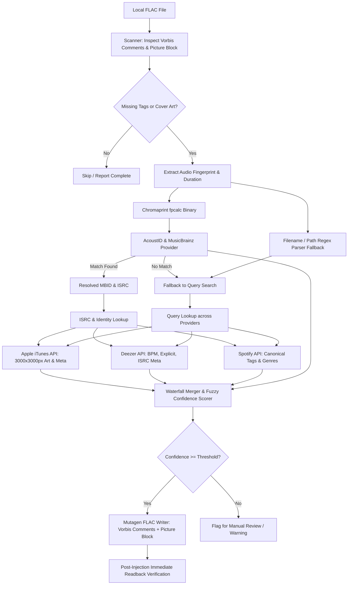

# flac-meta-injector

[](https://www.python.org/downloads/)
[](https://opensource.org/licenses/MIT)
[](https://github.com/astral-sh/ruff)

A production-grade CLI and Python library that losslessly scans local `.flac` audio tracks with missing, stripped, or incomplete metadata, resolves canonical track identity across major music streaming services and databases, and injects standardized **Vorbis Comments** and **ultra high-resolution cover art (up to 3000x3000px)**.

---

## Key Features

- **Lossless Metadata Surgery**: Direct header and block manipulation via `mutagen.flac.FLAC`—no re-encoding, preserving 100% bit-perfect audio stream integrity.
- **Acoustic Audio Fingerprinting**: Uses Chromaprint (`fpcalc`) and AcoustID to recognize tracks by actual audio waveform, completely bypassing stripped or wrong filenames.
- **Intelligent Provider Waterfall Pipeline**:
  - **AcoustID & MusicBrainz**: Authoritative MBIDs (`MUSICBRAINZ_TRACKID`, `MUSICBRAINZ_ALBUMID`), artist credits, and ISRC codes.
  - **Apple iTunes Search API**: Zero-auth public search dynamically upgraded from 100x100 thumbnails to **3000x3000px** uncompressed master artwork directly from Apple's CDN.
  - **Deezer Public API**: Zero-auth endpoint providing exact track **BPM (tempo)**, explicit advisory ratings, and ISRC validation.
  - **Spotify Web API**: Enriched streaming metadata via Client Credentials flow.
- **Fuzzy Confidence Scoring**: Uses RapidFuzz token sorting and duration discrepancy penalties ($| \Delta\text{duration} | > 3\text{s}$) to guard against false-positive tag injection.
- **Rich Interactive CLI**: Built with `typer` and `rich`, featuring visual scan tables, before/after inspection, dry-run simulation, and immediate post-write read-back verification.

---

## Architecture & Resolution Waterfall



---

## Prerequisites & System Dependencies

`flac-meta-injector` requires **Python 3.11+** and two external CLI binaries:
1. **`ffmpeg`** (used for synthetic test audio generation and audio analysis)
2. **`fpcalc`** (Chromaprint acoustic fingerprint generator)

### Installing System Dependencies

#### Windows (via WinGet or Chocolatey)
```powershell
# Using WinGet (Recommended)
winget install Gyan.FFmpeg.Essentials
winget install AcoustID.Chromaprint

# Or using Chocolatey
choco install ffmpeg chromaprint
```

#### macOS (via Homebrew)
```bash
brew install ffmpeg chromaprint
```

#### Linux (Debian / Ubuntu)
```bash
sudo apt-get update
sudo apt-get install -y ffmpeg libchromaprint-tools
```

---

## Installation

1. **Clone the repository**:
   ```bash
   git clone https://github.com/your-username/flac-meta-injector.git
   cd flac-meta-injector
   ```

2. **Create and activate a virtual environment**:
   ```bash
   # Windows PowerShell
   python -m venv .venv
   .\.venv\Scripts\Activate.ps1

   # Linux / macOS
   python3 -m venv .venv
   source .venv/bin/activate
   ```

3. **Install dependencies**:
   ```bash
   pip install -e ".[dev]"
   ```

---

## Configuration (`.env`)

Copy `.env.example` to `.env` to customize operational settings or configure optional provider credentials:

```bash
cp .env.example .env
```

| Environment Variable | Default Value | Description |
|---|---|---|
| `ACOUSTID_API_KEY` | *(Built-in open key)* | Your AcoustID API key (register for free at [acoustid.org](https://acoustid.org/)). |
| `SPOTIFY_CLIENT_ID` | `None` *(Optional)* | Spotify Developer Client ID for enhanced streaming metadata. |
| `SPOTIFY_CLIENT_SECRET` | `None` *(Optional)* | Spotify Developer Client Secret. |
| `MUSICBRAINZ_USER_AGENT` | `flac-meta-injector/...` | User-Agent header compliant with MusicBrainz terms. |
| `RATE_LIMIT_DELAY` | `1.0` | Minimum delay in seconds between calls to polite endpoints (MusicBrainz). |
| `COVER_ART_MIN_RESOLUTION` | `600` | Minimum acceptable cover art width/height in pixels. |
| `CONFIDENCE_THRESHOLD` | `0.70` | Minimum composite confidence score ($0.0 - 1.0$) to auto-inject tags. |
| `FPCALC_PATH` | `fpcalc` | Path or command name for the `fpcalc` executable. |

> **Note:** Both **Apple iTunes** and **Deezer** operate without any API keys or credentials. If Spotify or AcoustID keys are omitted, the tool automatically uses public endpoints and filename heuristics.

---

## CLI Usage & Command Reference

The command-line interface is available via `flac-meta-injector` or `python -m flac_injector.cli`.

```text
Usage: flac-meta-injector [OPTIONS] COMMAND [ARGS]...

Commands:
  scan         Scan local FLAC tracks and report metadata and cover art completeness.
  inspect      Inspect detailed Vorbis Comment tags and Picture blocks of a FLAC file.
  fingerprint  Generate Chromaprint fingerprint and parse filename heuristics.
  inject       Scan and inject standardized Vorbis Comments and cover art into FLAC files.
```

---

### 1. `scan` — Audit Missing Tags & Cover Art

Scans a single `.flac` file or an entire directory tree and renders a formatted table showing metadata health, missing core fields, and cover art resolution.

```bash
# Scan a folder recursively
flac-meta-injector scan ./music/

# Scan only the top-level directory (non-recursive)
flac-meta-injector scan ./music/ --no-recursive

# Show only incomplete files missing tags or art
flac-meta-injector scan ./music/ --only-incomplete
```

**Example Output:**
```text
                          FLAC Metadata Scan Results                           
┌──────────┬──────────┬──────────┬──────────┬──────────┬───────────┬──────────┐
│ Track /  │          │          │          │  Cover   │           │ Missing  │
│ Path     │ Title    │ Artist   │ Album    │   Art    │  Status   │ Fields   │
├──────────┼──────────┼──────────┼──────────┼──────────┼───────────┼──────────┤
│ Daft     │ -        │ -        │ -        │ MISSING  │ INCOMPLE… │ ALBUM,   │
│ Punk -   │          │          │          │          │           │ ARTIST,  │
│ One More │          │          │          │          │           │ DATE,    │
│ Time.fl… │          │          │          │          │           │ GENRE,   │
│          │          │          │          │          │           │ TITLE,   │
│          │          │          │          │          │           │ TRACKNU… │
└──────────┴──────────┴──────────┴──────────┴──────────┴───────────┴──────────┘
┌─────────────────── Scan Summary ───────────────────┐
│ Total Scanned: 1  |  Complete: 0  |  Incomplete: 1 │
└────────────────────────────────────────────────────┘
```

---

### 2. `inspect` — Detailed Vorbis Comment & Picture Block Viewer

Performs deep introspection of a FLAC file, displaying audio stream properties (sample rate, bit depth, channels, duration), all existing Vorbis comments, and embedded Picture block technical specifications.

```bash
flac-meta-injector inspect ./music/track.flac
```

**Example Output:**
```text
┌─────────────────────── FLAC Audio Stream Properties ────────────────────────┐
│ Path: ./music/Daft Punk - One More Time.flac                                │
│ Duration: 05:20 (320.12s)                                                   │
│ Format: 44100 Hz, 2 Ch, 16-bit                                              │
└─────────────────────────────────────────────────────────────────────────────┘
                       Vorbis Comments                        
┌─────────────────────┬──────────────────────────────────────┐
│ Tag Key             │ Value(s)                             │
├─────────────────────┼──────────────────────────────────────┤
│ ALBUM               │ Discovery                            │
│ ALBUMARTIST         │ Daft Punk                            │
│ ARTIST              │ Daft Punk                            │
│ DATE                │ 2001-03-12                           │
│ DISCNUMBER          │ 1                                    │
│ DISCTOTAL           │ 1                                    │
│ GENRE               │ Electronic // French House           │
│ ISRC                │ GBDUW0100055                         │
│ ITUNESADVISORY      │ 2                                    │
│ MUSICBRAINZ_ALBUMID │ aca0f087-e163-4d52-80fc-a78851dcb0d7 │
│ MUSICBRAINZ_TRACKID │ fad84787-2d80-487c-9f5e-da616829235b │
│ TITLE               │ One More Time                        │
│ TRACKNUMBER         │ 1                                    │
│ TRACKTOTAL          │ 14                                   │
│ YEAR                │ 2001                                 │
└─────────────────────┴──────────────────────────────────────┘
┌─ Embedded Picture Block ─┐
│ Type: Cover (front) (3)  │
│ MIME: image/jpeg         │
│ Resolution: 3000x3000    │
│ Bit Depth: 24-bit        │
│ Size: 1558.1 KB          │
└──────────────────────────┘
```

---

### 3. `fingerprint` — Acoustic Fingerprint & Heuristic Parser

Runs `fpcalc` against an audio file, prints its Chromaprint representation, and parses candidate hints from filenames and directory hierarchies.

```bash
flac-meta-injector fingerprint ./music/"01 - Daft Punk - One More Time.flac"
```

**Example Output:**
```text
┌──── Acoustic Fingerprint ──────────────────────┐
│ File: 01 - Daft Punk - One More Time.flac      │
│ Duration: 320.00s                              │
│ Chromaprint Fingerprint:                       │
│ AQAAA0mUaEkSRZEGAAyV4...                       │
└────────────────────────────────────────────────┘
 Parsed Heuristic Metadata Hints 
┌──────────────┬───────────────┐
│ Field        │ Value         │
├──────────────┼───────────────┤
│ Title        │ One More Time │
│ Artist       │ Daft Punk     │
│ Album        │ None          │
│ Track_number │ 1             │
└──────────────┴───────────────┘
```

---

### 4. `inject` — Resolve & Inject Metadata and High-Res Cover Art

Executes the waterfall pipeline against audio tracks.

```bash
# 1. Preview changes safely without modifying files (Dry-Run mode)
flac-meta-injector inject ./music/ --dry-run

# 2. Inject missing metadata and cover art into a single file
flac-meta-injector inject ./music/track.flac

# 3. Inject across a folder with a custom confidence threshold (0.0 to 1.0)
flac-meta-injector inject ./music/ --threshold 0.75

# 4. Force-overwrite existing non-empty tags with canonical metadata
flac-meta-injector inject ./music/ --overwrite
```

**CLI Flags for `inject`:**
- `--dry-run`: Simulates provider resolution and prints what tags and artwork would be written without altering disk files.
- `--threshold, -t FLOAT`: Minimum confidence score (default `0.70`) required to execute injection.
- `--overwrite`: Overwrites existing non-empty Vorbis comments. By default (`--no-overwrite`), existing non-empty tags are preserved and only missing fields are injected.
- `--recursive / --no-recursive, -r`: Recurse into subdirectories (default: `True`).

---

## Standard Vorbis Comment Tag Mapping

`flac-meta-injector` maps canonical metadata into standardized uppercase Vorbis comment keys:

| Canonical Field | Vorbis Comment Key | Example Value | Source / Notes |
|---|---|---|---|
| Track Title | `TITLE` | `One More Time` | Authoritative |
| Artist Name | `ARTIST` | `Daft Punk` | Authoritative |
| Album Name | `ALBUM` | `Discovery` | Authoritative |
| Album Artist | `ALBUMARTIST` | `Daft Punk` | Fallback to `ARTIST` if single artist |
| Track Number | `TRACKNUMBER` | `1` | Formatted without leading zeroes |
| Total Tracks | `TRACKTOTAL` | `14` | Canonical release size |
| Disc Number | `DISCNUMBER` | `1` | Multi-disc support |
| Disc Total | `DISCTOTAL` | `1` | Multi-disc support |
| Release Date | `DATE` | `2001-03-12` | Full ISO-8601 string |
| Release Year | `YEAR` | `2001` | 4-digit calendar year |
| Genre(s) | `GENRE` | `Electronic` | Multi-value comment block |
| ISRC Code | `ISRC` | `GBDUW0100055` | Authoritative 12-char identifier |
| Tempo (BPM) | `BPM` | `123.0` | Extracted via Deezer audio analysis |
| Advisory | `ITUNESADVISORY` | `2` | `1` = Explicit, `2` = Clean |
| AcoustID GUID | `ACOUSTID_ID` | `aca0f087-...` | Acoustic fingerprint lookup |
| MusicBrainz Recording ID | `MUSICBRAINZ_TRACKID` | `fad84787-...` | MusicBrainz WS2 |
| MusicBrainz Release ID | `MUSICBRAINZ_ALBUMID` | `aca0f087-...` | MusicBrainz WS2 |
| Cover Artwork | `Picture Block (Type 3)`| *Binary JPEG/PNG* | Up to **3000x3000px** uncompressed |

---

## Verification & Testing

The repository includes a comprehensive test suite with synthetic audio fixtures generated via `ffmpeg` (sine waves):

```bash
# Run the complete test suite
pytest -v

# Run targeted test suites
pytest tests/test_scanner.py -v
pytest tests/test_merger.py -v
pytest tests/test_providers.py -v
pytest tests/test_writer.py -v

# Run linting and code quality checks
ruff check src tests
```

---

## License

This project is licensed under the MIT License — see the [LICENSE](LICENSE) file for details.
