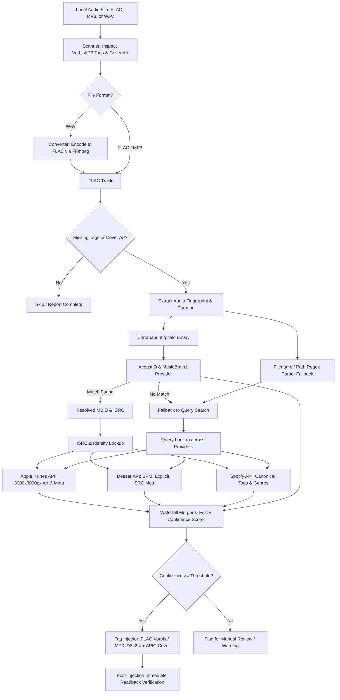

# flac-meta-injector

[](https://www.python.org/downloads/)
[](https://opensource.org/licenses/MIT)
[](https://github.com/astral-sh/ruff)

A production-grade CLI and Python library that losslessly scans local audio files (**FLAC** and **MP3**), converts uncompressed **WAV** tracks into bit-perfect FLAC, resolves canonical track identity across major music streaming services and databases, and injects standardized **Vorbis Comments / ID3v2.4 tags** and **ultra high-resolution cover art (up to 3000x3000px)**.

---

## Key Features

- **Multi-Format Lossless Metadata Surgery**: Direct header and tag manipulation via `mutagen.flac.FLAC` (Vorbis Comments & Picture blocks) and `mutagen.mp3.MP3` (ID3v2.4 & APIC frames)—no audio re-encoding, preserving 100% bit-perfect audio stream integrity.
- **WAV to Lossless FLAC Conversion**: Built-in audio conversion engine powered by FFmpeg converting uncompressed `.wav`, `.wave`, `.aiff` files to FLAC with custom compression levels and automatic post-conversion tagging.
- **Acoustic Audio Fingerprinting**: Uses Chromaprint (`fpcalc`) and AcoustID to recognize tracks by actual audio waveform, completely bypassing stripped or wrong filenames across FLAC, MP3, and WAV.
- **Intelligent Provider Waterfall Pipeline**:
  - **AcoustID & MusicBrainz**: Authoritative MBIDs (`MUSICBRAINZ_TRACKID`, `MUSICBRAINZ_ALBUMID`), artist credits, and ISRC codes.
  - **Apple iTunes Search API**: Zero-auth public search dynamically upgraded from 100x100 thumbnails to **3000x3000px** uncompressed master artwork directly from Apple's CDN.
  - **Deezer Public API**: Zero-auth endpoint providing exact track **BPM (tempo)**, explicit advisory ratings, and ISRC validation.
  - **Spotify Web API**: Enriched streaming metadata via Client Credentials flow.
- **Fuzzy Confidence Scoring**: Uses RapidFuzz token sorting and duration discrepancy penalties ($| \Delta\text{duration} | > 3\text{s}$) to guard against false-positive tag injection.
- **Rich Interactive CLI**: Built with `typer` and `rich`, featuring visual scan tables with audio format indicators, before/after inspection, dry-run simulation, and immediate post-write read-back verification.

---

## Architecture & Resolution Waterfall



---

## Prerequisites & System Dependencies

`flac-meta-injector` requires **Python 3.11+** and two external CLI binaries:
1. **`ffmpeg`** (used for audio conversion and audio analysis)
2. **`fpcalc`** (Chromaprint acoustic fingerprint generator)

### Installing System Dependencies

#### Windows (via WinGet or Chocolatey)
```powershell
# Using WinGet (Recommended)
winget install Gyan.FFmpeg.Essentials
winget install AcoustID.Chromaprint

# Or using Chocolatey
choco install ffmpeg chromaprint
```

#### macOS (via Homebrew)
```bash
brew install ffmpeg chromaprint
```

#### Linux (Debian / Ubuntu)
```bash
sudo apt-get update
sudo apt-get install -y ffmpeg libchromaprint-tools
```

---

## Installation

1. **Clone the repository**:
   ```bash
   git clone https://github.com/your-username/flac-meta-injector.git
   cd flac-meta-injector
   ```

2. **Create and activate a virtual environment**:
   ```bash
   # Windows PowerShell
   python -m venv .venv
   .\.venv\Scripts\Activate.ps1

   # Linux / macOS
   python3 -m venv .venv
   source .venv/bin/activate
   ```

3. **Install dependencies in editable mode**:
   ```bash
   pip install -e ".[dev]"
   ```

---

## Configuration (`.env`)

Copy `.env.example` to `.env` to customize operational settings or configure optional provider credentials:

```bash
cp .env.example .env
```

| Environment Variable | Default Value | Description |
|---|---|---|
| `ACOUSTID_API_KEY` | *(Built-in open key)* | Your AcoustID API key (register for free at [acoustid.org](https://acoustid.org/)). |
| `SPOTIFY_CLIENT_ID` | `None` *(Optional)* | Spotify Developer Client ID for enhanced streaming metadata. |
| `SPOTIFY_CLIENT_SECRET` | `None` *(Optional)* | Spotify Developer Client Secret. |
| `MUSICBRAINZ_USER_AGENT` | `flac-meta-injector/...` | User-Agent header compliant with MusicBrainz terms. |
| `RATE_LIMIT_DELAY` | `1.0` | Minimum delay in seconds between calls to polite endpoints (MusicBrainz). |
| `COVER_ART_MIN_RESOLUTION` | `600` | Minimum acceptable cover art width/height in pixels. |
| `CONFIDENCE_THRESHOLD` | `0.70` | Minimum composite confidence score ($0.0 - 1.0$) to auto-inject tags. |
| `FPCALC_PATH` | `fpcalc` | Path or command name for the `fpcalc` executable. |

> **Note:** Both **Apple iTunes** and **Deezer** operate without any API keys or credentials. If Spotify or AcoustID keys are omitted, the tool automatically uses public endpoints and filename heuristics.

---

## CLI Usage & Command Reference

The command-line interface is available via `flac-meta-injector` or `python -m flac_injector.cli`.

```text
Usage: flac-meta-injector [OPTIONS] COMMAND [ARGS]...

Commands:
  scan         Scan audio files (FLAC, MP3, WAV) and report metadata and cover art completeness.
  inspect      Inspect detailed tags, properties, and cover art blocks of an audio file.
  fingerprint  Generate Chromaprint fingerprint and parse filename heuristics.
  inject       Scan and inject standardized metadata and cover art into FLAC and MP3 files.
  convert      Convert WAV / uncompressed audio files into FLAC and optionally inject tags.
```

---

### 1. `scan` — Audit Missing Tags & Cover Art (FLAC, MP3, WAV)

Scans a single audio file or an entire directory tree and renders a formatted table showing format, metadata health, missing core fields, and cover art resolution.

```bash
# Scan a folder recursively
flac-meta-injector scan ./music/

# Scan only the top-level directory (non-recursive)
flac-meta-injector scan ./music/ --no-recursive

# Show only incomplete files missing tags or art
flac-meta-injector scan ./music/ --only-incomplete
```

**Example Output:**
```text
                          Audio Metadata Scan Results                          
┌─────────┬────────┬─────────┬─────────┬─────────┬─────────┬─────────┬────────┐
│ Track / │        │         │         │         │  Cover  │         │ Missi… │
│ Path    │ Format │ Title   │ Artist  │ Album   │   Art   │ Status  │ Fields │
├─────────┼────────┼─────────┼─────────┼─────────┼─────────┼─────────┼────────┤
│ Daft    │  FLAC  │ One     │ Daft    │ Vitamin │   OK    │ COMPLE… │ -      │
│ Punk -  │        │ More    │ Punk    │ House   │ (3000x… │         │        │
│ One     │        │ Time    │         │         │         │         │        │
│ More    │        │         │         │         │         │         │        │
│ Time.f… │        │         │         │         │         │         │        │
│ Daft    │  MP3   │ Techno… │ Daft    │ Human   │   OK    │ COMPLE… │ -      │
│ Punk -  │        │         │ Punk    │ After   │ (1500x… │         │        │
│ Techno… │        │         │         │ All     │         │         │        │
│ Kraftw… │  WAV   │ -       │ -       │ -       │ MISSING │ INCOMP… │ ALBUM, │
│ - The   │        │         │         │         │         │         │ ARTIS… │
│ Robots… │        │         │         │         │         │         │ DATE,  │
└─────────┴────────┴─────────┴─────────┴─────────┴─────────┴─────────┴────────┘
┌─────────────────────────────── Scan Summary ────────────────────────────────┐
│ Total Scanned: 3 (FLAC: 1  |  MP3: 1  |  WAV: 1)  |  Complete: 2  |         │
│ Incomplete: 1                                                               │
└─────────────────────────────────────────────────────────────────────────────┘
```

---

### 2. `inspect` — Detailed Tag & Picture Block Viewer

Performs deep introspection of a FLAC, MP3, or WAV file, displaying audio stream properties, all existing Vorbis comments / ID3 frames, and embedded cover art specifications.

```bash
# Inspect a FLAC file
flac-meta-injector inspect ./music/track.flac

# Inspect an MP3 file
flac-meta-injector inspect ./music/track.mp3

# Inspect a WAV file
flac-meta-injector inspect ./music/recording.wav
```

**Example Output (MP3 with ID3v2.4 and APIC Cover Art):**
```text
┌────────────────────────── Audio Stream Properties ──────────────────────────┐
│ Path: ./music/Daft Punk - Technologic.mp3                                   │
│ Format: MP3                                                                 │
│ Duration: 04:44 (284.12s)                                                   │
│ Specs: 44100 Hz, 2 Ch, 16-bit                                               │
└─────────────────────────────────────────────────────────────────────────────┘
            ID3 Tags             
┌─────────────┬─────────────────┐
│ Tag Key     │ Value(s)        │
├─────────────┼─────────────────┤
│ ALBUM       │ Human After All │
│ ALBUMARTIST │ Daft Punk       │
│ ARTIST      │ Daft Punk       │
│ DATE        │ 2005-03-09      │
│ DISCNUMBER  │ 1/1             │
│ GENRE       │ House           │
│ ISRC        │ GBDUW0400109    │
│ TITLE       │ Technologic     │
│ TRACKNUMBER │ 9               │
│ TRACKTOTAL  │ 10              │
└─────────────┴─────────────────┘
┌─────────── Attached Picture (APIC) ───────────┐
│ Type: Cover (front) (PictureType.COVER_FRONT) │
│ MIME: image/jpeg                              │
│ Resolution: 1500x1500                         │
│ Bit Depth: 24-bit                             │
│ Size: 273.9 KB                                │
└───────────────────────────────────────────────┘
```

---

### 3. `inject` — Resolve & Inject Metadata into FLAC and MP3

Executes the waterfall pipeline to resolve and write canonical metadata and high-res cover art.

```bash
# 1. Preview changes safely without modifying files (Dry-Run mode)
flac-meta-injector inject ./music/ --dry-run

# 2. Inject missing metadata and cover art into a single FLAC or MP3
flac-meta-injector inject ./music/track.mp3

# 3. Inject across a folder with a custom confidence threshold (0.0 to 1.0)
flac-meta-injector inject ./music/ --threshold 0.75

# 4. Force-overwrite existing tags with fresh canonical metadata
flac-meta-injector inject ./music/ --overwrite

# 5. Disable auto-converting WAV files when processing mixed folders
flac-meta-injector inject ./music/ --no-convert-wav
```

**CLI Flags for `inject`:**
- `--dry-run`: Simulates provider resolution and prints what tags and artwork would be written without altering disk files.
- `--threshold, -t FLOAT`: Minimum confidence score (default `0.70`) required to execute injection.
- `--overwrite`: Overwrites existing non-empty tags. By default (`--no-overwrite`), existing non-empty tags are preserved and only missing fields are injected.
- `--convert-wav / --no-convert-wav`: Auto-converts any discovered WAV files to FLAC and injects tags into the resulting FLAC (default: `True`).
- `--recursive / --no-recursive, -r`: Recurse into subdirectories (default: `True`).

---

### 4. `convert` — Convert WAV / Audio to FLAC with Auto-Injection

Losslessly encodes uncompressed audio files (`.wav`, `.wave`, `.aiff`, `.aif`) to FLAC using FFmpeg, and automatically resolves and injects metadata into the resulting tracks.

```bash
# 1. Convert a WAV file to FLAC and auto-inject metadata and cover art
flac-meta-injector convert ./music/recording.wav

# 2. Convert an entire folder of WAV files into a dedicated FLAC directory
flac-meta-injector convert ./uncompressed_wavs/ --output-dir ./flac_library/

# 3. Convert and delete source WAV files only after verified conversion
flac-meta-injector convert ./music/ --delete-original

# 4. Convert without injecting metadata (pure audio conversion)
flac-meta-injector convert ./music/ --no-inject

# 5. Customize FLAC compression level (0-12, default 8)
flac-meta-injector convert ./music/ --compression-level 8
```

**CLI Flags for `convert`:**
- `--output-dir, -o PATH`: Optional destination folder for converted FLAC files.
- `--inject / --no-inject`: Automatically resolve and inject metadata after conversion (default: `True`).
- `--delete-original`: Safely delete source WAV file after verified FLAC creation (default: `False`).
- `--compression-level, -c INT`: FLAC compression level (0–12, default: `8`).
- `--threshold, -t FLOAT`: Minimum confidence threshold for auto-injection (default: `0.70`).
- `--dry-run`: Preview conversion paths without modifying files.

---

### 5. `fingerprint` — Acoustic Fingerprint & Heuristic Parser

Runs `fpcalc` against an audio file, prints its Chromaprint representation, and parses candidate hints from filenames and directory hierarchies.

```bash
flac-meta-injector fingerprint ./music/"01 - Daft Punk - One More Time.mp3"
```

---

## Standard Tag Mapping Across Formats

`flac-meta-injector` automatically maps canonical metadata across both **FLAC Vorbis Comments** and **MP3 ID3v2.4 frames**:

| Canonical Field | FLAC Vorbis Tag | MP3 ID3v2.4 Frame | Example Value |
|---|---|---|---|
| Track Title | `TITLE` | `TIT2` | `One More Time` |
| Lead Artist | `ARTIST` | `TPE1` | `Daft Punk` |
| Album Name | `ALBUM` | `TALB` | `Discovery` |
| Album Artist | `ALBUMARTIST` | `TPE2` | `Daft Punk` |
| Track Number / Total | `TRACKNUMBER`, `TRACKTOTAL` | `TRCK` (`num/total`) | `1/14` |
| Disc Number / Total | `DISCNUMBER`, `DISCTOTAL` | `TPOS` (`num/total`) | `1/1` |
| Release Date | `DATE`, `YEAR` | `TDRC` | `2001-03-12` |
| Genre(s) | `GENRE` | `TCON` | `Electronic` |
| ISRC Code | `ISRC` | `TSRC` | `GBDUW0100055` |
| Tempo (BPM) | `BPM` | `TBPM` | `123.0` |
| Advisory | `ITUNESADVISORY` | `TXXX:ITUNESADVISORY` | `1` (Explicit) / `2` (Clean) |
| MusicBrainz Recording ID | `MUSICBRAINZ_TRACKID` | `TXXX:MusicBrainz Track Id` | `fad84787-...` |
| MusicBrainz Album ID | `MUSICBRAINZ_ALBUMID` | `TXXX:MusicBrainz Album Id` | `aca0f087-...` |
| Cover Artwork | `Picture Block (Type 3)` | `APIC (Type 3: Front)` | Up to **3000x3000px** uncompressed |

---

## Verification & Testing

The repository includes a comprehensive 34-test suite covering FLAC, MP3, and WAV workflows with synthetic audio fixtures generated via `ffmpeg`:

```bash
# Run the complete test suite
pytest -v

# Run targeted test suites
pytest tests/test_converter.py -v   # WAV to FLAC conversion tests
pytest tests/test_mp3.py -v         # MP3 ID3 & APIC injection tests
pytest tests/test_scanner.py -v     # Multi-format scanner tests
pytest tests/test_merger.py -v      # Waterfall and fuzzy match tests
pytest tests/test_providers.py -v   # Async API provider tests
pytest tests/test_writer.py -v      # Mutagen writer verification tests

# Run code quality and linting checks
ruff check src tests
```

---

## License

This project is licensed under the MIT License — see the [LICENSE](LICENSE) file for details.
